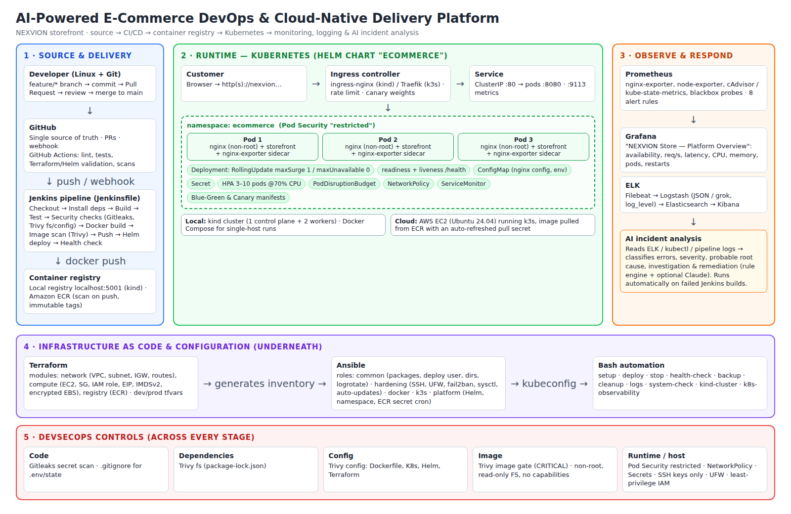
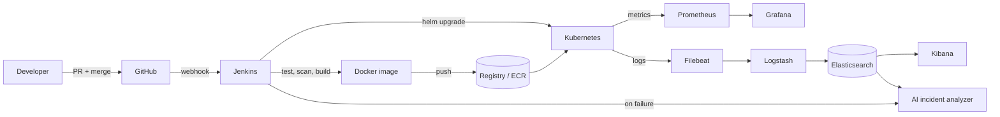

# Architecture



## Layers

1. **Source and delivery**: developers work on Linux with Git and push feature branches to GitHub.
   GitHub Actions validates every PR. Jenkins runs the delivery pipeline on `main` (see
   [pipeline](images/pipeline.png)).
2. **Runtime**: the storefront image (non-root Nginx serving static files) runs on Kubernetes through the
   `ecommerce` Helm chart. Locally that is a 3-node kind cluster. In the cloud it is k3s on an EC2 instance.
   Docker Compose provides a single-host alternative.
3. **Observe and respond**: Prometheus scrapes the nginx-exporter sidecar, node and container metrics, and
   blackbox probes. Grafana visualises them. Filebeat ships JSON access logs through Logstash into
   Elasticsearch/Kibana. The AI incident analyzer reads those logs (or kubectl/pipeline output) and
   produces an incident report.
4. **Infrastructure underneath**: Terraform creates the AWS network, instance, IAM role and ECR repository,
   then writes the Ansible inventory. Ansible configures the server (hardening, Docker, k3s, Helm) and
   writes the kubeconfig Jenkins uses.
5. **Security throughout**: secret, dependency, configuration and image scans gate the pipeline. Runtime
   hardening (Pod Security "restricted", read-only root FS, dropped capabilities, NetworkPolicy, UFW,
   key-only SSH, least-privilege IAM) protects what runs.

## Application analysis

| Item | Finding |
|---|---|
| Frontend | 3 pages (`index`, `products`, `payment`), vanilla JS, Google Fonts, Unsplash images |
| Backend / database | None. Cart, accounts and orders are kept in browser `localStorage` (demo) |
| Build process | None originally; added lint → test → `dist/` + `version.json` |
| Runtime | Any static web server; Nginx (unprivileged) chosen, port 8080 |
| Health endpoint | Added `/health` (JSON) in Nginx |
| Logs | Nginx access log as structured JSON to stdout; error log to stderr |
| Environment variables | `APP_ENV`, `STORE_NAME`, `LOG_FORMAT` (ConfigMap); secret keys reserved for a future payment gateway |
| Ports | 8080 container · 8082 Compose host · 8088 kind ingress · 80/443 cloud |

## Data flow of a release



## Repository layout

```
ai-ecommerce-devops/
├── application/          storefront source, tests, build script
├── scripts/              Bash operational automation
├── docker/               Dockerfile, .dockerignore, docker-compose.yml, nginx config
├── jenkins/              Jenkinsfile
├── terraform/            main/provider/variables/outputs + modules/ + environments/
├── ansible/              inventory, playbook.yml, group_vars, roles/
├── kubernetes/           namespace, deployment, service, configmap, secret, ingress, hpa, pdb, netpol, strategies/
├── helm/ecommerce/       Helm chart
├── monitoring/           prometheus/, grafana/
├── logging/elk/          filebeat, logstash, kibana setup
├── security/             scan.sh, gitleaks.toml, hardening notes
├── ai/incident-analysis/ analyzer, rules, samples, tests
├── docs/                 documentation + diagrams
└── README.md
```
